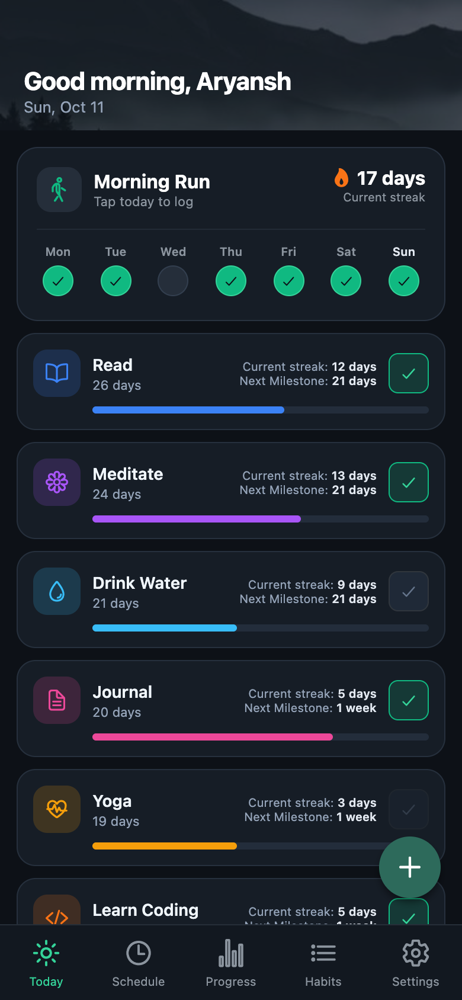
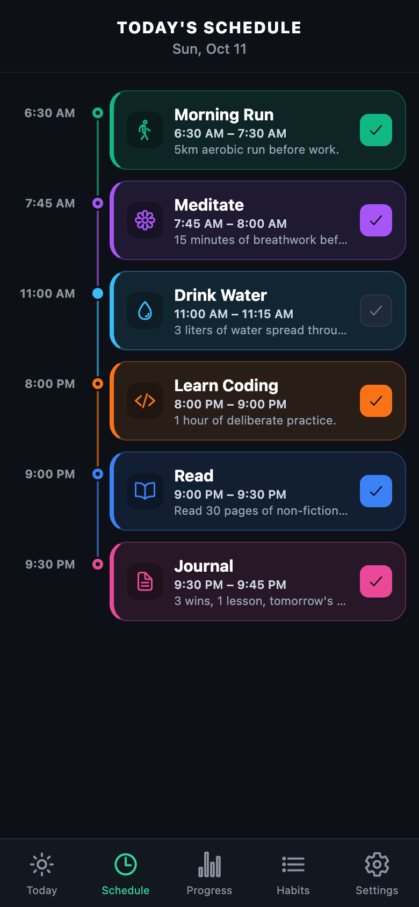
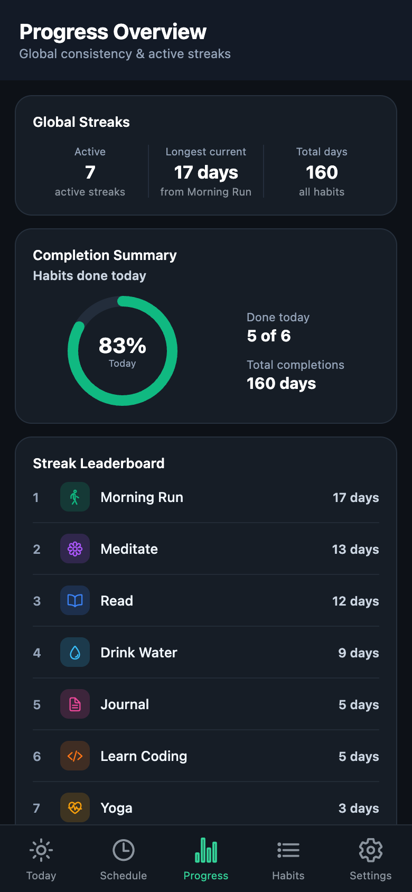
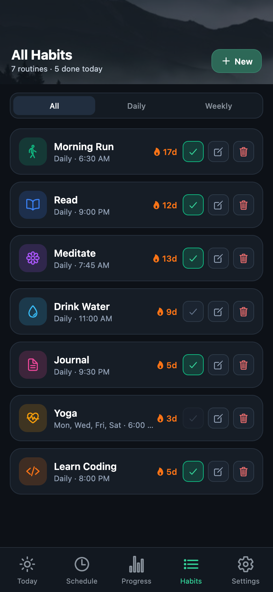
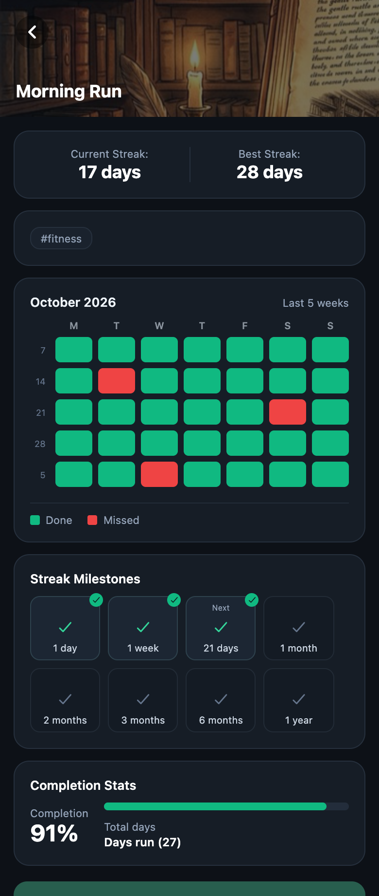
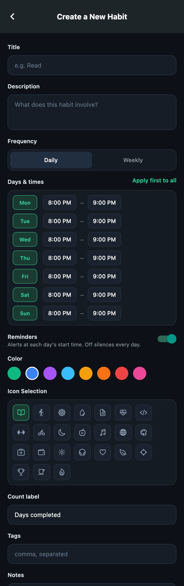
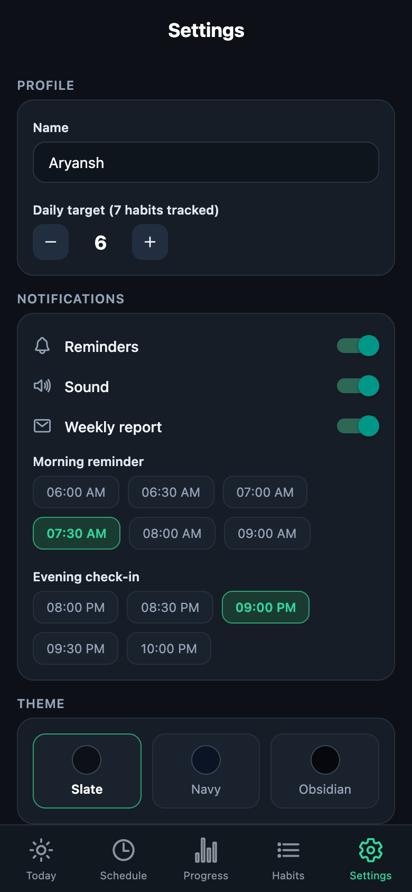

# Habitat

A full-stack habit tracker: a Spring Boot REST API backed by Postgres, and an Expo/React Native client that renders whatever the server says — no business logic (streaks, heatmaps, scheduling) is duplicated on the client.

This repository is the mobile client. The API lives in the [server repository](https://github.com/AryanshTripathi/Habitat----Server/).

- **Server** — [Habitat----Server](https://github.com/AryanshTripathi/Habitat----Server/) (Spring Boot 4.1.1, Java 21, Maven). The API, database and tests live in that repository.
- **Client** — this repository (Expo SDK 52 / React Native 0.76, TypeScript). See [Client (mobile app)](#client-mobile-app) below.
- **Deployed** on Render (API) + Neon (Postgres), kept warm by a scheduled health-check ping. The mobile app is built with EAS Build.

```
 Expo / React Native app ──HTTPS + X-Timezone header──▶ Spring Boot API (Render) ──▶ Postgres (Neon)
  renders the server's answers,                          streaks, heatmap, schedule,
  validates input, local reminders                       "today" in the user's time zone
```

## Design decisions

### Storing completion dates only, not a full daily log

The naive options for tracking a streak were either a row for *every* day (including non-completions), which wastes space, or recomputing the whole history on every read, which wastes time. Instead, `HabitLog` only stores the dates a habit was actually completed, alongside the habit's schedule (e.g. "weekly on Mon and Thu").

When the client sends a completion, the server doesn't need to scan history to know if the streak continues — it only has to check one thing: was the *previous scheduled day* also completed? If yes, the streak continues; if not, it restarts at 1. This is the `walkBackToNearestScheduledDay` + `existsByHabit_IdAndCompletionDate` check in `HabitService.completeHabit`, and it's O(1) regardless of how long the habit has existed.

### Resetting a stale streak: cron vs. compute-on-read

A streak that's only ever updated by `completeHabit`/`undoCompletion` can go stale the moment a scheduled day is missed — nothing proactively sets it back to 0 until the user opens the app and logs something new.

Two designs were considered:
- **A nightly cron** (e.g. 2 AM IST) that walks every habit, checks whether yesterday's scheduled day was missed, and zeroes the streak if so.
- **Computing the "effective" streak at read time instead** — when a habit is fetched, check once whether the single most recent scheduled day before today was completed. If it was, the stored streak is still valid. If not, the streak is effectively 0, regardless of how long ago it broke.

The second option won: it's a single cheap repository check per read (`computeEffectiveCurrentStreak` in `HabitService`), it needs no scheduler/infrastructure, and it can't drift out of sync the way a once-a-day cron could (e.g. a user in a different timezone, or the cron simply not running). The *stored* `currentStreak` is only ever physically corrected the next time `completeHabit`/`undoCompletion` runs — reads never mutate it, they just report the truth.

### Field-by-field updates instead of a generic merge

An early design considered using an object-mapper-style merge (e.g. Jackson's `ObjectReader.readerForUpdating`) to apply a `PUT` body onto the existing entity. This was dropped for three reasons:
1. It would overwrite every field on every `PUT`, even ones the client didn't intend to touch.
2. With JPA cascades on (`HabitSchedule`/`HabitLog` are `CascadeType.ALL` children of `Habit`), a generic merge risks touching related rows — like completion logs — that an update call should never be able to modify.
3. Filtering out the fields that shouldn't be touched is possible, but re-deriving that filter for a cascading object graph is worse than just being explicit.

Instead, `HabitService.applyEditableFields` sets each editable field individually, and immutable fields (`name`, `currentStreak`, `maxStreak`, `totalXpEarned`) simply have no setter reachable from `HabitRequest` at all — protection is enforced by the request DTO's shape, not by the service remembering what to ignore.

### Effective-dated schedule history (no deletions)

Changing a habit's schedule used to directly mutate or delete the `HabitSchedule` row for a day. That broke the heatmap: if Monday was scheduled, then later removed, the server had no way to tell that Monday *used to* be scheduled when resolving a MISSED/DONE/EMPTY cell for a date before the removal — the heatmap could only ever see today's current schedule, not what was true historically.

Fixed by adding `effectiveFrom`/`effectiveUntil` to `HabitSchedule` and never deleting a row on removal — `syncSchedule` closes it out (`effectiveUntil = today`) instead. Two views now exist on `Habit`:
- `getHabitSchedule()` — the full history, including closed-out rows. Used only by the heatmap, which needs to judge each past date against whatever was active *then* (`HabitSchedule.isActiveOnDate`).
- `getActiveHabitSchedule()` — only currently-active rows (`effectiveUntil == null`). Used by everything that means "what's scheduled right now": completing/undoing a habit, the client-facing schedule list, and `/schedule/today`.

No row is ever deleted, so there is no data loss when a schedule changes.

### Time zones: the client says where it is

The calendar date drives everything: which day a completion belongs to, `scheduledToday`, streaks, the week row and the heatmap. The server used `LocalDate.now()` in its own zone (UTC on Render), so for a user in India the date was wrong between 00:00 and 05:30 IST.

Converting schedule times to UTC was rejected: it moves the weekday of some rows, can't store a range that crosses UTC midnight, drifts in zones with daylight saving, and wouldn't fix the date problem anyway (completions are stored as dates).

Instead the client sends its IANA zone in an `X-Timezone` header on every request, and `UserClock` (`com.habitat.server.time`) is the single place that decides "today" and "now":
- it reads the header from the current request; a missing or invalid value falls back to `habitat.default-timezone` (env `HABITAT_DEFAULT_TIMEZONE`), or to the server's own zone when that is blank;
- no other code calls `LocalDate.now()`; `createdOn`/`updatedOn` are stamped through an auditing `DateTimeProvider` that uses it, and `Habit.addSchedule`/`syncSchedule` take the date as a parameter;
- schedule `startTime`/`endTime` are plain wall-clock values and are not converted;
- rows saved before this change keep their old dates (only completions logged between 00:00 and 05:30 IST could be one day off).

### Deployment: keeping Render and Neon warm

Both halves of the deployed stack sleep on free tiers, independently:
- **Render** spins the web service down after ~15 minutes of no incoming requests; the next request pays a ~60-90s cold start.
- **Neon** suspends its compute endpoint after a shorter idle window (~5 minutes by default on the free tier) even if Render is awake.

A `GET /health` endpoint (`HealthController`) that does a cheap `habitRepository.count()` forces a real round-trip to the database, not just a response from the JVM — so a ping only keeps the app server warm is not enough, it has to touch Postgres too. An external cron (cron-job.org) hits it every few minutes, comfortably inside Neon's shorter idle window, which also keeps Render well inside its own.

Decisions about the mobile app (server as the source of truth, cold starts, validation, time handling) are under [Client design decisions](#client-design-decisions).

## Bugs caught by the test suite

The project is tested in three layers — plain unit tests on the domain model (`Habit`, `HabitSchedule`), Mockito-based service tests, `@WebMvcTest` controller slices, and full `@SpringBootTest` integration tests against a real (embedded) database. All of the following were caught by writing or running these tests, not in manual testing:

1. **`updateHabit` NPE on a null schedule** — a `PUT` body with no `habitSchedule` field caused a `NullPointerException` (calling `.stream()` on `null`). Caught by `updateHabit_whenIncomingScheduleIsNull_doesNotThrow`; fixed by null-checking before processing the incoming schedule list.

2. **Stale lookup map let two *new* days collide** — `syncSchedule`'s existing-schedule lookup map is built once from the habit's current schedule. If the *incoming* list itself contained two rows for the same day-of-week (both new, neither matching an existing row), both would independently pass through as "new" and get added, silently creating two rows for one day. Caught by `syncSchedule_duplicateDayInIncomingList_throwsDuplicateScheduleException`; fixed by validating the incoming list for internal duplicates up front, independent of what's already stored.

3. **Asymmetric duplicate protection** — the fix above only covered two *new* duplicate days; a duplicate where *one* incoming row matched an existing day (taking the "update in place" branch) and a second incoming row also targeted that same day wasn't caught by the same logic path. Caught by `syncSchedule_duplicateIncomingDayMatchingAnExistingDay_alsoThrows`; fixed by making the incoming-list duplicate check unconditional, run before either branch.

4. **`addSchedule` infinite recursion** — the bidirectional `Habit`↔`HabitSchedule` association was originally kept in sync from both sides (`addSchedule` added to the list and called `schedule.setHabit(this)`, which itself tried to add the schedule back to the habit's list), recursing forever. Caught by `addSchedule_setsBackReferenceToThisHabit`; fixed by having exactly one side (`addSchedule`) own both the list mutation and the back-reference.

5. **`createHabit` skipped duplicate-day validation** — `updateHabit`/`syncSchedule` validated duplicate schedule days, but the creation path built schedule entities directly without routing them through the same check. Caught by `createHabit_duplicateScheduleDay_throwsDuplicateScheduleException`; fixed by having `createHabit` add each schedule row through `addSchedule`, inheriting its duplicate-day guard instead of re-implementing it.

6. **`@WebMvcTest` slices failed to start because of JPA auditing** — `@EnableJpaAuditing` lived on the main `@SpringBootApplication` class, so any `@WebMvcTest` (which only boots the web layer, not JPA) failed trying to initialize auditing infrastructure it has no `EntityManager` for. Fixed by moving `@EnableJpaAuditing` into its own `JpaAuditingConfig` class, decoupled from the application's bootstrap class.

7. **`undoCompletion` infinite loop when a habit's schedule was empty** — walking backward to find "the previous scheduled day" (`walkBackToNearestScheduledDay`) assumes at least one scheduled day exists. `completeHabit` is naturally guarded (it rejects completion on an unscheduled day before ever walking back), but `undoCompletion` had no equivalent guard — undoing a completion logged *before* the habit's last schedule row was removed would loop forever with no scheduled days left to find. Fixed with an explicit guard that stops the walk-back once the habit's active schedule is empty.

8. **Effective-dating regressions, caught while reviewing the schedule-history fix (see above):**
   - `HabitSchedule.isActiveOnDate` used a strict `isAfter(effectiveFrom)`, so a row wasn't considered active on the exact day it started (e.g. a brand-new schedule wasn't "active" on its own creation day). Fixed to `!date.isBefore(effectiveFrom)`.
   - `addSchedule`'s and `syncSchedule`'s internal checks initially read the *raw* schedule list (including already-closed rows) instead of the active-only view. This both permanently blocked re-adding a previously removed day (a closed row still "matched" on day-of-week) and, far more seriously, caused `syncSchedule`'s close-out loop to re-stamp `effectiveUntil = today` on rows that had already been closed weeks earlier, corrupting their true closure date every time `syncSchedule` ran for any reason. Fixed by routing those checks through `getActiveHabitSchedule()`.
   - Once re-adding a removed day was fixed, a second latent bug surfaced: building `syncSchedule`'s lookup map from the raw list would find two rows sharing a day-of-week (one closed, one active) and throw on the duplicate map key. Fixed by building that map from the active-only view too.
   - The heatmap briefly regressed to only ever seeing the *active* schedule (because `getHabitSchedule()` was temporarily changed to filter down to active rows for other reasons), silently defeating the entire point of effective-dating — past dates could no longer be checked against a schedule that had since been closed out. Fixed by keeping `getHabitSchedule()` as the full, unfiltered history and introducing `getActiveHabitSchedule()` as the separate active-only view, rather than overloading one method to mean two different things.
   - A date exactly equal to "today" was resolving to `MISSED` instead of `EMPTY` if the habit was scheduled but not yet completed — telling the user they'd missed a habit before the day was even over. Fixed by excluding today (and future dates) from the `MISSED` branch in `resolveDayStatus`.

   All of the above are covered by dedicated regression tests: `HabitScheduleTest` (date-boundary unit tests for `isActiveOnDate`), `HabitTest` (re-add-after-removal, no-restamping-of-closed-rows), and `HabitServiceTest`/`HabitIntegrationTests` (end-to-end heatmap resolution across a mid-history schedule change, and today-shows-`EMPTY`-not-`MISSED`).

## API

| Method | Path | Purpose |
|---|---|---|
| GET | `/habits` | List all habits (summary, no heatmap) |
| POST | `/habits` | Create a habit |
| GET | `/habits/{id}` | Habit detail, including the 5-week heatmap |
| PUT | `/habits/{id}` | Update a habit's editable fields and/or schedule |
| DELETE | `/habits/{id}` | Delete a habit |
| POST | `/habits/complete/{id}` | Log today's completion |
| POST | `/habits/undo/{id}` | Undo today's completion |
| GET | `/schedule/today` | Every habit scheduled for today, ordered by start time |
| GET | `/health` | Keep-alive probe (see [Deployment](#deployment-keeping-render--neon-warm)) |

### Request headers

| Header | Required | Purpose |
|---|---|---|
| `X-Timezone` | No | The caller's IANA time zone (e.g. `Asia/Kolkata`). The server uses it to decide what "today" is. Missing or invalid values fall back to the default zone. See [Time zones](#time-zones-the-client-says-where-it-is). |
| `Content-Type: application/json` | On POST/PUT | JSON bodies. |

### Payloads

`POST /habits` and `PUT /habits/{id}` take a `HabitRequest`:

```json
{
  "name": "Read",
  "description": "30 pages",
  "notes": "No phone",
  "icon": "book-outline",
  "color": "AMBER",
  "unitLabel": "Days read",
  "frequencyType": "WEEKLY",
  "reminderEnabled": true,
  "isActive": true,
  "tags": ["mind"],
  "habitSchedule": [
    { "dayOfWeek": "MONDAY", "startTime": "21:00", "endTime": "21:30" }
  ]
}
```

- `color` is one of `RED, BLUE, GREEN, PINK, PURPLE, SKY_BLUE, AMBER, ORANGE`; `frequencyType` is `DAILY` or `WEEKLY` (a `DAILY` habit has all 7 days).
- Schedule times are wall-clock times in the user's own zone and are never converted. One row per day; `startTime` is also the reminder time. `endTime` of `00:00` means the end of the day.
- Responses (`HabitResponse`) carry the stored fields plus values the server derives: effective `currentStreak`, `maxStreak`, `completedToday`, `scheduledToday`, `totalDaysCompleted`, and `weekStatus` (7 booleans, Mon–Sun). `GET /habits/{id}` adds `heatmap` (5 weeks × 7 days of `DONE` / `MISSED` / `EMPTY`).
- `GET /schedule/today` returns `habitId, name, icon, color, description, startTime, endTime, reminderEnabled, completedToday` per row.

## Tech stack

### Server

- Spring Boot 4.1.1 / Spring Framework 7.0.9 / Hibernate ORM 7.4.5, Java 21, Maven (`./mvnw`)
- JPA auditing for `createdOn`/`updatedOn`
- H2 (in-memory) for local dev and tests, Postgres (Neon) in production — same JPA code, swapped via datasource config
- JUnit 5, Mockito, AssertJ, `@WebMvcTest` slices, and full `@SpringBootTest` integration tests against a real embedded H2 database

### Client

- Expo SDK 52, React Native 0.76, React 18, TypeScript
- React Navigation 6 (bottom tabs + native stack)
- `fetch`-based API layer (no HTTP library), React context for state
- AsyncStorage (settings and a saved copy of the habits), `expo-notifications` (local reminders), `react-native-svg` (progress ring), `@react-native-community/datetimepicker`
- Runs on Android and iOS (Expo Go or an EAS build) and on the web (`npm run web`)

## Client (mobile app)

### Screens

<table>
  <tr>
    <td align="center"><br><sub>Today</sub></td>
    <td align="center"><br><sub>Schedule</sub></td>
    <td align="center"><br><sub>Progress</sub></td>
    <td align="center"><br><sub>Habits</sub></td>
  </tr>
  <tr>
    <td align="center"><br><sub>Habit Detail</sub></td>
    <td align="center"><br><sub>Create / Edit</sub></td>
    <td align="center"><br><sub>Settings</sub></td>
    <td></td>
  </tr>
</table>

<sub>Screenshots are from the web build with demo data.</sub>

| Tab / screen | What it does |
|---|---|
| **Today** | Misty header, the featured habit (highest current streak) with a Mon–Sun row where only today can be toggled, habit cards with a progress bar toward the next milestone, add (+) button. Pull down to refresh. |
| **Schedule** | Today's timeline from `GET /schedule/today`: each scheduled habit with its start–end time. The check completes or undoes the habit. |
| **Progress** | Active streaks, longest current streak, total days, a ring showing today's completion (habits done ÷ habits scheduled today) and a streak leaderboard. |
| **Habits** | Filter (All / Daily / Weekly), complete, edit and delete. |
| **Settings** | Name, daily target, notification toggles and times, theme, JSON export, reset. Stored on the device only. |
| **Habit Detail** | Current vs max streak, read-only 5-week heatmap, milestone badges, completion stats, tags and notes. |
| **Create / Edit** (modal) | Title, description, Daily/Weekly, per-day start and end time, reminders switch, color, icon, count label, tags, notes. |

### Project layout

| Path | Contents |
|---|---|
| `App.tsx`, `index.js` | Navigation (tabs + stack) and the entry point |
| `src/api/` | `config` (server URL, timeouts), `client` (the 8 endpoint calls), `mappers` (server JSON ⇄ app types), `validation` (rules checked before POST/PUT), `timezone` (the `X-Timezone` value), `errors`, `types` (DTOs) |
| `src/context/HabitContext.tsx` | All habit state: loading, the saved copy, retry, and every action (complete/undo, create, update, delete) |
| `src/screens/`, `src/components/` | The screens above; `SyncBanner`, `HeroBanner`, `ProgressRing` |
| `src/utils/` | `time` (HH:mm rules), `dates`, `milestones`, `colors`, `habits`, `notifications` |

### Configuration and running

The server address is one value, `EXPO_PUBLIC_API_URL`, read in `src/api/config.ts`:

| Where the app runs | Address used when the variable is unset |
|---|---|
| iOS simulator, web | `http://localhost:8080` |
| Android emulator | `http://10.0.2.2:8080` |
| A physical phone | Set the variable: your computer's LAN IP (`http://192.168.1.20:8080`) or the deployed URL |

For local runs put it in `.env` (git-ignored; copy `.env.example`). `EXPO_PUBLIC_` values are baked into the app when it is built, so changing one needs a new build. EAS cloud builds do not see `.env`, so the deployed URL is set per profile in `eas.json` (`preview` and `production`).

```bash
npm install
npx expo start                                   # scan the QR code with Expo Go
npm run web                                      # browser
npx tsc --noEmit                                 # type-check
eas build --platform android --profile preview   # installable Android build (needs `eas login`)
```

### How the client uses the API

| Call | Used by |
|---|---|
| `GET /habits` | App start, pull-to-refresh on Today, returning to the foreground, retry |
| `GET /habits/{id}` | Habit Detail (heatmap), when it opens and after each completion or edit |
| `POST /habits`, `PUT /habits/{id}` | Create / Edit, after client-side validation |
| `DELETE /habits/{id}` | Delete on the Habits tab |
| `POST /habits/complete/{id}`, `/undo/{id}` | The check buttons on Today, Schedule, Habits and Detail |
| `GET /schedule/today` | The Schedule tab each time it is shown (built from the saved habits until it answers) |

The mappers translate between the two sides: `name` ⇄ `title`, `MONDAY…SUNDAY` ⇄ day index 0–6, `21:00:00` → `21:00`, `DONE/MISSED/EMPTY` → lower case, and the `Color` enum ⇄ the app's hex colors.

### Client design decisions

**The server is the source of truth.** Streaks, the week row, the heatmap and "scheduled today" come from the API, and the app renders each response (complete/undo are not optimistic). The client computes only presentation: the milestone ladder and bar, which habit is featured, which banner image a habit uses, the progress ring, and input validation.

**Cold starts: show something while the server wakes up.** Render's free tier sleeps, and waking takes a minute or more. So:
- The `GET /habits` request starts the moment the app opens, with a 120-second timeout (other calls use 60).
- After every confirmed response the habits are saved to AsyncStorage (`habitat_habits_cache_v1`). On the next launch that copy is shown immediately and replaced when the server answers. A copy from an earlier day has "done today" cleared so nothing wrongly shows as done.
- With nothing saved yet, the app shows placeholder cards, and a small banner says "Connecting to the server…". If the server can't be reached, the banner offers a retry and the app retries every 20 seconds. Only "nothing saved and unreachable" gets a full-screen error.
- Changes (complete, undo, create, edit, delete) are refused until the server has answered, with a message saying so.
- The saved copy is only for display and is read once at startup; while the app runs the screens use the in-memory habits. Switching between Today, Habits and Progress does not refetch; Schedule and Detail refetch when opened. Changes made from another device appear after a launch, a return to the app, or a pull-to-refresh.
- If the `Habit` fields the client stores ever change, bump the cache key so old saved copies are ignored.

**Validate before sending.** Every POST and PUT is checked first (`src/api/validation.ts`), and the same rules show inline in the form:

| Field | Rule |
|---|---|
| Title | Required, at most 60 characters. It can't be changed after creation (the client sends the existing title on edit). |
| Description, notes | At most 255 characters each |
| Count label | Required, at most 30 characters |
| Color, icon | Must be a valid color / icon |
| Tags | At most 10, up to 20 characters each, lowercase letters, numbers, `-` and `_`, no duplicates |
| Schedule | At least one day, each day once; a Daily habit has all 7 days |
| Times | `HH:mm`; the end time is required and must be after the start on the same day |

The server should enforce the same rules; the client check does not protect it from other callers.

**Time handling.** Schedule times are the user's local wall-clock `HH:mm`, one row per day, never converted. The end time defaults to one hour after the start (a start at 23:00 or later ends at `00:00`, meaning 12:00 AM, the end of the day), moves with the start so the length stays the same, and can't be on or before the start. A habit can't run past midnight. The user's zone goes to the server in the `X-Timezone` header (see [Time zones](#time-zones-the-client-says-where-it-is)).

**Reminders are local.** `expo-notifications` schedules one weekly alert per scheduled day at that day's start time, only when the habit's reminders switch is on, plus the morning and evening check-ins from Settings. The server does not send notifications.

**Milestones are a client-side concept.** The ladder is 1 day, 1 week, 21 days, 1 month, 2 months, 3 months, 6 months, 1 year, then every further year. The progress bar is the current streak over the next milestone.

### Known limitations

- On the web, `Alert.alert` does nothing, so the delete confirmation and other alert messages don't appear in a browser (they work on phones).
- Web has no native time picker (a plain `HH:mm` field is used) and no scheduled notifications.
- Staleness windows of the saved copy are described above; there is no polling.
- Writes need a connected server; there is no offline queue.

